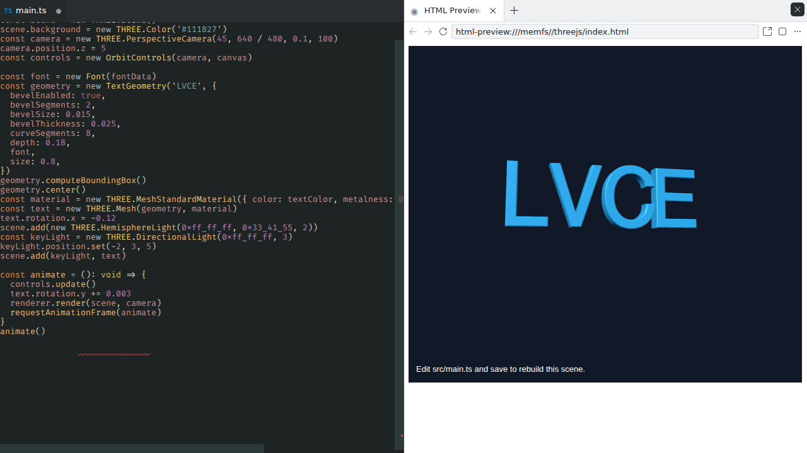

# Three.js demo

[Open the demo](https://lvce-editor.github.io/threejs-demo/).

Edit an npm Three.js scene in TypeScript with Lvce Editor. The GitHub Pages site
opens `src/main.ts` beside a live preview. Saving rebuilds `dist/main.js` with
esbuild-wasm in the browser. TypeScript and ESLint diagnostics run through the
editor's extensions.



The starting scene is a rotating cube. Change `cubeColor` in `src/main.ts` and
save to see the new color. A compilation error keeps the last successful preview;
correct the source and save to recover.

```sh
npm ci
npm run build
npm test
npm run type-check
npm run lint
npx playwright install chromium firefox
npm run e2e:headless
```

The build exports `.tmp/static` under the `/threejs-demo` URL prefix. GitHub
Actions validates pull requests and publishes merged `main` to GitHub Pages.
The site build precompiles the initial scene and verifies its inputs before using
it. Edits compile in the browser with a reusable esbuild context; the demo needs
no development server.

After deployment, compare the published assets with the validated build and check
animation, preview close/reopen, edits, diagnostics, reloads, OrbitControls and
completions in Chromium and Firefox. The local acceptance server instruments the
sandbox worker to check its contexts and timers throughout those scenarios.
